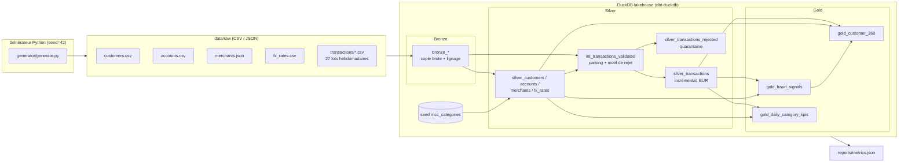

# Pipeline ELT Lakehouse de transactions bancaires

Pipeline ELT de bout en bout, exécutable en local en une commande. Il génère un flux de paiements carte, l'ingère dans un lakehouse DuckDB organisé en architecture médaillon (bronze / silver / gold) avec **dbt-core + dbt-duckdb**, contrôle la qualité avec **59 tests dbt**, puis publie des métriques mesurées pendant l'exécution dans `reports/metrics.json`.

> **Données 100 % SYNTHÉTIQUES.** Les clients, comptes, commerçants, montants et cours de change sont générés par un script Python avec une graine fixe (`generator/generate.py`). Aucune donnée réelle ni aucune donnée de BNP Paribas Cardif n'est utilisée. Les noms de personnes et de commerçants sont fictifs et les e-mails utilisent le domaine réservé `example.com`.

Auteur : **Rody Brayan DAMA**, alternant AI / Data Engineer chez BNP Paribas Cardif.

## Contexte métier

Une banque reçoit chaque semaine des lots de transactions carte issus de plusieurs systèmes (monétique, e-commerce, DAB). Les données brutes posent les problèmes habituels de la production :

| Problème injecté dans les données brutes | Traitement dans le pipeline |
|---|---|
| Doublons exacts et rejeux d'un même `transaction_id` dans un lot ultérieur | Déduplication silver, la dernière ingestion l'emporte (`unique_key` incrémental) |
| Identifiants de compte nuls, commerçants inconnus | Lignes mises en quarantaine (`silver_transactions_rejected`) avec un motif |
| Dates hétérogènes (`ISO`, `AAAA-MM-JJ HH:MM:SS`, `JJ/MM/AAAA HH:MM`) ou invalides (`N/A`, `2025-13-45…`) | Parsing multi-format, rejet si la date reste illisible |
| Montants nuls ou avec virgule décimale française (`12,50`) | Normalisation, rejet des montants nuls ou ≤ 0 |
| Devises inconnues (`XXX`, `BTC`…) ou mal formatées (` eur `) | Normalisation, rejet des devises absentes du référentiel de change |
| Cours de change non publiés le week-end, publication dupliquée | `ASOF JOIN` sur le dernier cours connu, puis test de fraîcheur du cours |
| Enregistrements tardifs (*late-arriving*, jusqu'à 4 semaines de retard) | Modèle incrémental sur `ingested_at`, drapeau `is_late_arrival` |
| Clients renvoyés avec une mise à jour (SCD), e-mails vides, dates de naissance illisibles | Dernière version par `updated_at`, champs nullables documentés |
| Catégorie commerçant manquante | Complétée à partir du référentiel MCC (seed dbt) |
| Rafales de fraude (cartes compromises, e-commerce de nuit à l'étranger) et montants aberrants | Mart de signaux de fraude à base de règles explicables |

Les marts gold répondent à trois usages : le **pilotage** (KPIs quotidiens par catégorie de commerçant), la **connaissance client** (vue client 360) et la **sécurité** (alertes de fraude notées par un score).

## Architecture



**Orchestration** (`python -m pipeline run`) :

1. génère les fichiers bruts synthétiques dans `data/raw/` ;
2. repart d'un entrepôt DuckDB vide ;
3. lance `dbt build` en **chargement initial** sur tous les lots sauf le dernier (variable `ingest_until`) ;
4. relance `dbt build` en **incrémental** : seul le dernier lot, qui contient des enregistrements tardifs et des rejeux, est traité par `silver_transactions` (`delete+insert` sur `transaction_id`) ;
5. mesure les volumes dans DuckDB, lit les `run_results.json` de dbt et écrit `reports/metrics.json`. Le code de sortie est non nul si un test échoue.

## Structure du dépôt

```
banking-lakehouse-pipeline/
├── generator/generate.py          # générateur seedé, injection des défauts de qualité et de la fraude
├── pipeline/run.py                # orchestrateur (python -m pipeline run)
├── models/
│   ├── bronze/                    # sources (read_csv/read_json) + tables bronze
│   ├── silver/                    # nettoyage, déduplication, typage, conversion EUR, incrémental
│   └── gold/                      # KPIs, client 360, signaux de fraude
├── macros/                        # parsing dates/montants/devises, nommage des schémas
├── tests/
│   ├── generic/                   # tests génériques maison : positive_value, unique_combination_of_columns
│   └── *.sql                      # tests singuliers : réconciliation gold/silver, conversion FX, fraîcheur FX, taux de rejet
├── seeds/mcc_categories.csv       # référentiel MCC -> catégorie
├── reports/metrics.json           # métriques mesurées lors de la dernière exécution complète
├── .github/workflows/ci.yml       # CI : pipeline sur un échantillon + dbt build
├── dbt_project.yml / profiles.yml
└── requirements.txt / requirements.lock.txt
```

## Exécution

Prérequis : Python 3.12. Docker n'est pas nécessaire.

```bash
python -m venv .venv
# Windows : .venv\Scripts\activate    |    Linux/macOS : source .venv/bin/activate
pip install -r requirements.txt

# Exécution complète : environ 500 000 transactions générées, build initial puis incrémental, métriques
python -m pipeline run

# Échantillon rapide (identique à la CI)
python -m pipeline run --n-transactions 20000 --n-customers 2000 --n-merchants 300

# Options : --seed 42  --threads 4  --skip-generate (réutilise data/raw)  --docs (dbt docs generate)
```

Pour explorer les résultats :

```bash
dbt docs generate --profiles-dir . && dbt docs serve --profiles-dir .    # lignage + descriptions
python -c "import duckdb; print(duckdb.connect('warehouse/lakehouse.duckdb', read_only=True).sql('select * from gold.gold_daily_category_kpis order by transaction_date desc limit 10'))"
```

## Résultats (exécution réelle)

Les valeurs ci-dessous sont recopiées de `reports/metrics.json`, produit par `python -m pipeline run --docs` (seed 42, 500 000 transactions demandées) sur un PC portable Windows 11 avec Python 3.12.0, dbt-core 1.11.17, dbt-duckdb 1.11.1 et DuckDB 2.0.0.

| Indicateur | Valeur |
|---|---|
| Transactions brutes (bronze, 27 lots) | **508 103** |
| Transactions après nettoyage (silver) | **493 637** |
| Lignes rejetées et mises en quarantaine | 8 046 (**1,584 %**) |
| Doublons et rejeux supprimés | 6 420 |
| Lignes retirées au total (rejets + doublons) | 2,847 % |
| Rejets par motif | timestamp invalide 2 044 · compte manquant 2 026 · montant invalide 1 504 · devise inconnue 1 459 · commerçant inconnu 1 013 |
| Transactions hors EUR converties | 72 697 |
| Enregistrements tardifs conservés | 10 636 |
| Clients : brut → silver | 20 500 → 20 000 |
| Lignes silver après le chargement initial | 489 880 |
| Lignes ajoutées par l'exécution incrémentale (dernier lot) | 3 757 |
| Modèles dbt | 15 (+1 seed) |
| **Tests dbt réussis** | **59 / 59** (à chacune des deux exécutions) |
| Alertes fraude (dont HIGH) | 6 060 (813) |
| Rappel des règles sur les rafales injectées | 93,84 % (1 233 / 1 314) |
| Part des alertes provenant des rafales injectées | 20,35 % |
| Durée : génération | 38,62 s |
| Durée : `dbt build` initial (temps mur / temps d'exécution dbt) | 171,43 s / 47,09 s |
| Durée : `dbt build` incrémental (temps mur / temps d'exécution dbt) | 82,46 s / 25,25 s |
| Durée : `dbt docs generate` | 60,24 s |
| **Durée totale** | **358,08 s** |

Comment lire ces chiffres :

- Le rappel de la détection de fraude est calculé sur des **labels synthétiques** : le générateur écrit dans `data/labels/injected_fraud.csv` les identifiants des rafales qu'il a injectées, et ce fichier ne passe jamais par l'ingestion. Les autres alertes viennent des montants aberrants injectés et de transactions normales qui déclenchent une règle (par exemple un achat élevé à l'étranger). Ce sont des faux positifs plausibles. Le résultat sert à vérifier que les règles se comportent comme prévu, pas à mesurer leur performance en production.
- L'écart entre le temps mur et le temps d'exécution dbt vient surtout du démarrage et du parsing de dbt sur ce poste Windows. La transformation elle-même prend environ 47 s pour environ 500 000 lignes, tests compris.

## Tests de qualité (59)

- **Génériques natifs** : `unique`, `not_null`, `relationships` (transactions → comptes → clients, transactions → commerçants, catégories → seed MCC), `accepted_values` (canal, statut, type de compte, segment, motif de rejet, niveau de risque).
- **Génériques maison** (`tests/generic/`) : `positive_value`, `unique_combination_of_columns` (une ligne par date et catégorie, un cours par jour et devise).
- **Singuliers** (`tests/`) :
  - `assert_amount_eur_matches_fx_rate` : la conversion EUR peut être recalculée à partir du montant et du cours ;
  - `assert_gold_kpis_reconcile_with_silver` : volumes et montants identiques entre gold et silver ;
  - `assert_fx_rate_not_stale` : le cours appliqué a au plus 4 jours ;
  - `assert_rejection_rate_below_threshold` : le taux de rejet reste sous 5 % (`max_rejection_rate`).

## Compétences démontrées

- **Data engineering** : architecture médaillon, ELT avec dbt, modèle incrémental (`delete+insert`), gestion des données tardives et des rejeux, quarantaine des rejets avec motif, lignage (`_source_file`, `_loaded_at`).
- **Qualité des données** : stratégie de tests à plusieurs niveaux (génériques, maison, singuliers, réconciliation), garde-fou sur le taux de rejet, métriques de qualité mesurées automatiquement.
- **SQL analytique (DuckDB)** : `ASOF JOIN` pour les cours de change, fenêtres glissantes temporelles (`RANGE INTERVAL`), `QUALIFY`, médiane fenêtrée, `arg_max`, agrégats filtrés.
- **Python** : génération de données vectorisée avec NumPy et seedée (reproductible), orchestration en sous-processus, collecte de métriques.
- **Domaine bancaire** : monétique carte, MCC, multi-devises, KPIs de refus et de panier moyen, vue client 360, règles de fraude explicables (vélocité, montant aberrant, e-commerce de nuit, pays différent).
- **Industrialisation** : CI GitHub Actions, dépendances épinglées, documentation dbt (descriptions et lignage), rejouable en une commande.

## Limites et pistes

- La médiane du compte utilisée par le signal « montant aberrant » est calculée sur toute la période et non sur un historique glissant. C'est une simplification acceptable pour une démonstration.
- Les règles de fraude sont volontairement simples et explicables. L'étape suivante serait un modèle supervisé entraîné sur la mart, avec un suivi de la précision.
- Le stockage est un fichier DuckDB local. Le même projet dbt pourrait écrire du Parquet ou de l'Iceberg sur un stockage objet (`materialized='external'` dans dbt-duckdb) ou être porté sur Snowflake ou Databricks.
- La CI exécute un échantillon de 20 000 transactions pour rester rapide. Le volume complet se lance en local.
